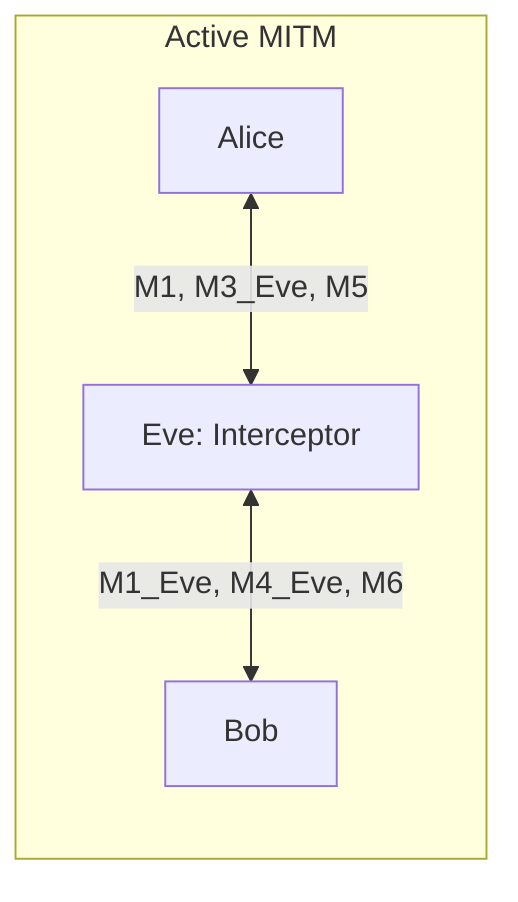

# 🔐 HomoKX — Key Exchange Built on Homomorphic Functions

<div align="center">

[](LICENSE)
[](https://vitejs.dev/)
[](https://react.dev/)
[](https://www.typescriptlang.org/)
[](https://tailwindcss.com/)
[](https://vitest.dev/)
[](https://vercel.com/)

<p align="center">
  <strong>A 3-Round Interactive Key Exchange Simulation Powered by Commutative Homomorphic Exponentiation</strong>
</p>

<p align="center">
  <em>Two parties agree on a high-entropy secret by blinding, swapping, and unblinding values with commutative homomorphic functions — without pre-shared secrets or Diffie-Hellman public keys.</em>
</p>

[**Live Demo**](#-zero-config-vercel-deployment) • [**Protocol Specification**](#-protocol-specification) • [**Adversary Analysis**](#-adversary-analysis-eve) • [**Mathematical Proof**](#-mathematical-foundation) • [**Test Suite**](#-automated-testing)

</div>

---

## 📖 Table of Contents

- [Overview](#-overview)
- [How It Works](#-how-it-works)
- [Protocol Specification](#-protocol-specification)
- [Mathematical Foundation](#-mathematical-foundation)
- [Adversary Analysis (Eve)](#-adversary-analysis-eve)
- [Diffie-Hellman vs. HomoKX](#-diffie-hellman-vs-homokx)
- [Interactive Simulator Features](#-interactive-simulator-features)
- [Automated Testing](#-automated-testing)
- [Quickstart & Development](#-quickstart--development)
- [Zero-Config Vercel Deployment](#-zero-config-vercel-deployment)
- [Security Notes & Limitations](#-security-notes--limitations)
- [License](#-license)

---

## 🌟 Overview

**HomoKX** is an educational cybersecurity web prototype demonstrating a key agreement protocol based on the **Shamir Three-Pass / Massey–Omura** cryptosystem, augmented with modern cryptographic hygiene:
- **Client-Side Pure BigInt**: Native arbitrary-precision integer arithmetic for modular exponentiation, modular inversion via Extended Euclid, and Miller-Rabin primality testing.
- **WebCrypto Integration**: Hardware-accelerated HKDF-SHA256 key derivation, HMAC-SHA256 mutual key confirmation, and ECDSA P-256 message signatures.
- **Dual Group Modes**:
  - **Production Group**: RFC 3526 §3 2048-bit MODP Group (Group 14).
  - **Toy Group**: Safe prime $p = 1019, q = 509$ for instant pedagogical inspection.
- **Active Adversary Modeling**: Interactive simulation of adversary **Eve** executing active Man-In-The-Middle (MITM) attacks and passive eavesdropping.

```
       ALICE                                                    BOB
  [Private: a1, a2]                                      [Private: b1, b2]
  [Secret:  K_A   ]                                      [Secret:  K_B   ]
          │                                                      │
          │─────── Round 1: M1 = K_A^a1 mod p ──────────────────>│
          │<────── Round 1: M2 = K_B^b2 mod p ───────────────────│
          │                                                      │
          │<────── Round 2: M3 = M1^b1 = K_A^(a1·b1) mod p ──────│
          │─────── Round 2: M4 = M2^a2 = K_B^(b2·a2) mod p ─────>│
          │                                                      │
          │─────── Round 3: M5 = M3^(a1^-1) = K_A^b1 mod p ─────>│
          │<────── Round 3: M6 = M4^(b2^-1) = K_B^a2 mod p ──────│
          │                                                      │
    Recovers K_B                                           Recovers K_A
  M6^(a2^-1) mod p                                       M5^(b1^-1) mod p
          │                                                      │
          └────────── Both compute SK via HKDF-SHA256 ───────────┘
```

---

## ⚡ How It Works

The key agreement takes place in three intuitive stages:

1. **Blind**: Each party independently generates a secret contribution ($K_A \in G_q$ for Alice, $K_B \in G_q$ for Bob) and raises it to an ephemeral private exponent ($a_1, b_2 \in [2, q-2]$).
2. **Swap (Super-Blind)**: Upon receiving the peer's blinded message, each party applies a second independent exponent ($b_1, a_2$). Because modular exponentiation is commutative in cyclic groups ($m^{ab} \equiv m^{ba} \pmod p$), both exponents mask the secret simultaneously.
3. **Unblind**: Each party strips off their initial blinding exponent using a modular inverse computed **modulo $q$** ($a_1^{-1} \pmod q, b_2^{-1} \pmod q$). The receiving party can then strip their remaining exponent, cleanly recovering the peer's contributed secret.

```
SK = HKDF-SHA256(
       ikm   = I2OSP(K_A) ‖ I2OSP(K_B),
       salt  = SHA-256(M_1 ‖ M_2 ‖ M_3 ‖ M_4 ‖ M_5 ‖ M_6),
       info  = "HomoKX v1",
       length = 32 bytes
     )
```

---

## 📐 Protocol Specification

### 1. Group Parameters
- Let $p = 2q + 1$ be a safe prime where $q$ is also prime.
- Operating domain: Cyclic subgroup $G_q \subset \mathbb{Z}_p^*$ of quadratic residues having prime order $q$.
- RFC 3526 Group 14 (2048-bit):
  $$\text{Hex: } \texttt{FFFFFFFF FFFFFFFF C90FDAA2 2168C234 \dots FFFFFFFF FFFFFFFF}$$

### 2. Ephemeral Secrets
- **Alice**: Picks random private exponents $a_1, a_2 \in [2, q-2]$ and secret contribution $K_A = r_A^2 \bmod p$ for random $r_A \in [2, p-2]$.
- **Bob**: Picks random private exponents $b_1, b_2 \in [2, q-2]$ and secret contribution $K_B = r_B^2 \bmod p$ for random $r_B \in [2, p-2]$.

### 3. Execution Rounds
| Step | Sender $\to$ Receiver | Message Value | Mathematical Interpretation |
|---|---|---|---|
| **Round 1 (A)** | $\text{Alice} \to \text{Bob}$ | $M_1 = K_A^{a_1} \bmod p$ | Alice blinds her secret $K_A$ |
| **Round 1 (B)** | $\text{Bob} \to \text{Alice}$ | $M_2 = K_B^{b_2} \bmod p$ | Bob blinds his secret $K_B$ |
| **Round 2 (B)** | $\text{Bob} \to \text{Alice}$ | $M_3 = M_1^{b_1} \bmod p$ | Bob super-blinds $M_1$: $K_A^{a_1 \cdot b_1} \bmod p$ |
| **Round 2 (A)** | $\text{Alice} \to \text{Bob}$ | $M_4 = M_2^{a_2} \bmod p$ | Alice super-blinds $M_2$: $K_B^{b_2 \cdot a_2} \bmod p$ |
| **Round 3 (A)** | $\text{Alice} \to \text{Bob}$ | $M_5 = M_3^{a_1^{-1} \bmod q} \bmod p$ | Alice removes $a_1$, leaving $K_A^{b_1} \bmod p$ |
| **Round 3 (B)** | $\text{Bob} \to \text{Alice}$ | $M_6 = M_4^{b_2^{-1} \bmod q} \bmod p$ | Bob removes $b_2$, leaving $K_B^{a_2} \bmod p$ |

### 4. Secret Recovery
- **Bob recovers $K_A$**:
  $$K_A = M_5^{b_1^{-1} \bmod q} = \left(K_A^{b_1}\right)^{b_1^{-1}} \equiv K_A \pmod p$$
- **Alice recovers $K_B$**:
  $$K_B = M_6^{a_2^{-1} \bmod q} = \left(K_B^{a_2}\right)^{a_2^{-1}} \equiv K_B \pmod p$$

### 5. On-the-Wire Subgroup Validation
Every received value $x \in \{M_1, \dots, M_6\}$ and recovered secret is strictly validated:
$$2 \le x \le p-2 \quad \text{and} \quad x^q \equiv 1 \pmod p$$
Any deviation immediately terminates the session with an `Invalid group element` exception.

### 6. Key Confirmation
$$\text{tag} = \text{HMAC-SHA256}(SK, \text{"confirm"} \parallel \text{role} \parallel \text{salt})$$
Alice sends $\text{tag}_A$ to Bob; Bob sends $\text{tag}_B$ to Alice. Both verify mutual ownership before application data transmission.

---

## 🧮 Mathematical Foundation

### Property 1: Multiplicative Homomorphism ($H_1$)
For any $m_1, m_2 \in G_q$ and exponent $k$:
$$E_k(m_1 \cdot m_2) = (m_1 \cdot m_2)^k \equiv m_1^k \cdot m_2^k \equiv E_k(m_1) \cdot E_k(m_2) \pmod p$$

### Property 2: Commutativity ($H_2$)
Successive exponentiations commute:
$$E_a(E_b(m)) = (m^b)^a \equiv m^{ab} \equiv m^{ba} \equiv (m^a)^b = E_b(E_a(m)) \pmod p$$

### Property 3: Subgroup Inversion Modulo $q$ ($H_3$)
Because $m \in G_q$, the order of $m$ divides $q$. By Lagrange's theorem, $m^q \equiv 1 \pmod p$.
Let $k \cdot k^{-1} = 1 + c \cdot q$ for some integer $c$:
$$E_{k^{-1}}(E_k(m)) = m^{k \cdot k^{-1}} = m^{1 + c \cdot q} = m^1 \cdot (m^q)^c \equiv m \cdot (1)^c \equiv m \pmod p$$

### Worked Example ($p=23, q=11$)
- Contribution $K = 4$ ($4^{11} \equiv 1 \pmod{23}$, valid quadratic residue).
- Exponents: $a = 3$, $b = 5$.
- Modular Inverses modulo $q=11$:
  - $a^{-1} \equiv 3^{-1} \equiv 4 \pmod{11}$ ($3 \times 4 = 12 \equiv 1 \pmod{11}$).
  - $b^{-1} \equiv 5^{-1} \equiv 9 \pmod{11}$ ($5 \times 9 = 45 \equiv 1 \pmod{11}$).
- Steps:
  1. $M_1 = 4^3 \bmod{23} = 64 \bmod{23} = 18$
  2. $M_3 = 18^5 \bmod{23} = 3$
  3. $M_5 = 3^4 \bmod{23} = 81 \bmod{23} = 12$
  4. Recovery: $K = 12^9 \bmod{23} = 4$ ✅

---

## 🕵️ Adversary Analysis (Eve)

HomoKX models both passive eavesdropping and active Man-In-The-Middle attacks:



### 1. Passive Eavesdropper
A passive observer captures wire transcripts $M_1 \dots M_6$. Because extracting $K_A$ from $K_A^{a_1}$ or $K_A^{b_1}$ requires solving the Discrete Logarithm Problem in $G_q$, the wiretap reveals zero plaintext entropy.

### 2. Active MITM (Unauthenticated Mode)
Without origin authentication, Eve acts as Bob towards Alice and as Alice towards Bob:
1. Eve intercepts $M_1 = K_A^{a_1}$, super-blinds with her own exponent $e_{B1}$, and returns $M_3 = M_1^{e_{B1}}$.
2. Alice unblinds $a_1$ and transmits $M_5 = K_A^{e_{B1}}$.
3. Eve unblinds with $(e_{B1})^{-1} \pmod q$, completely recovering $K_A$!
4. Eve executes the mirror attack against Bob, recovering $K_B$.
5. **Outcome**: Eve derives two separate session keys ($SK_{\text{Alice}} \ne SK_{\text{Bob}}$). Eve decrypts, modifies, and re-encrypts all subsequent communications.

### 3. Active MITM (Authenticated Mode — ECDSA P-256)
Alice and Bob pin each other's long-term ECDSA P-256 public keys:
- Every message includes an ECDSA signature over $(\text{round} \parallel \text{message} \parallel \text{session\_id})$.
- When Eve injects forged messages, the receiver verifies the signature against the pinned key.
- Verification fails immediately: **"Attack blocked — signature invalid, session aborted"**.

---

## 📊 Diffie-Hellman vs. HomoKX

| Feature | Diffie-Hellman (RFC 3526) | HomoKX (3-Pass Homomorphic) |
|---|---|---|
| **Interactive Rounds** | 1 round (2 unidirectional passes) | 3 rounds (6 messages) |
| **Exponentiations / Party** | 2 exponentiations | ~6 exponentiations |
| **Contributory Key Material** | Yes (both parties pick exponents) | Yes (both parties pick explicit secrets $K_A, K_B$) |
| **Perfect Forward Secrecy** | Yes (with ephemeral private keys) | Yes (with ephemeral exponents & contributions) |
| **Authentication** | None by default (requires SIGMA / TLS) | None by default / Optional ECDSA P-256 signatures |
| **Hardness Assumption** | CDH / DDH / Discrete Log | Subgroup Discrete Log (less standard than CDH) |

---

## 💻 Interactive Simulator Features

- **Alice & Bob Cards**: Individual cryptographic state with a blurred "reveal" eye toggle to inspect ephemeral secrets.
- **Real-Time Public Channel**: Animated packet movements with direction arrows, formulas, values, and a full-precision modal inspector.
- **Controls**: Single-step execution, 800ms auto-play, session reset, random secret generator, and a 2048-bit benchmark button.
- **Homomorphism Laboratory**: Live playground to test multiplicative homomorphism ($E_k(m_1 \cdot m_2)$) and commutativity ($E_a(E_b(m))$) with real-time `EQUAL ✓` badges.
- **Status Readout**: Subgroup validation checkmarks, 32-byte session key hex with copy button, HMAC key confirmation status, and millisecond execution timer.

---

## 🧪 Automated Testing

The project uses **Vitest** for rigorous cryptographic validation.

```bash
npm test
```

### Verified Test Suites:
1. `millerRabin`: 40-round primality verification for $p$ and $q$ on 2048-bit Group 14 and toy parameters.
2. `verifyH1, verifyH2, verifyH3`: 100 randomized trials asserting algebraic homomorphism, commutativity, and inversion.
3. `runFullProtocol`: 50 automated end-to-end runs verifying $SK_{\text{Alice}} == SK_{\text{Bob}}$.
4. `validateGroupElement`: Strict rejection of boundary values ($0, 1, p-1, p$) and quadratic non-residues.
5. `Worked Example`: Numerical check for $p=23, q=11, K=4, a=3, b=5$.
6. `simulateEve`: Verification of MITM compromise in unauthenticated mode and abortion in authenticated mode.
7. `I2OSP / OS2IP`: RFC 8017 BigInt octet serialization round-trip.

---

## 🚀 Quickstart & Development

### 1. Clone & Install
```bash
git clone https://github.com/shivam-core/homokx.git
cd homokx
npm install
```

### 2. Run Local Development Server
```bash
npm run dev
```
Open [http://localhost:5173](http://localhost:5173).

### 3. Build for Production
```bash
npm run build
```

---

## 🌐 Zero-Config Vercel Deployment

The project is pre-configured with [`vercel.json`](vercel.json) for instant deployment:

```bash
# Install Vercel CLI
npm install -g vercel

# Deploy directly
vercel --prod
```

Or connect the repository to the [Vercel Web Console](https://vercel.com/new). Select **Vite** preset and click **Deploy**.

---

## ⚠️ Security Notes & Limitations

> [!CAUTION]
> - **This is an educational prototype, not production cryptography.**
> - **Unauthenticated, the protocol is vulnerable to man-in-the-middle attacks, exactly like plain Diffie-Hellman. The authenticated mode fixes this with signatures.**
> - **It is a variant of the Shamir three-pass / Massey–Omura construction. It is less studied than Diffie-Hellman and costs 3 rounds instead of 1.**
> - **Security relies on the hardness of discrete logarithms in the order-q subgroup.**
> - **Exponents are never reused across runs. Received values are validated against small-subgroup attacks.**
> - **Use X25519 or ECDH with authentication in real systems.**

---

## 📄 License

This project is licensed under the [MIT License](LICENSE).
Built for educational and cybersecurity course research.
